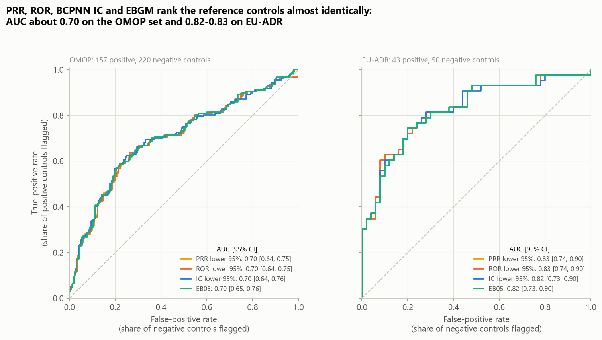
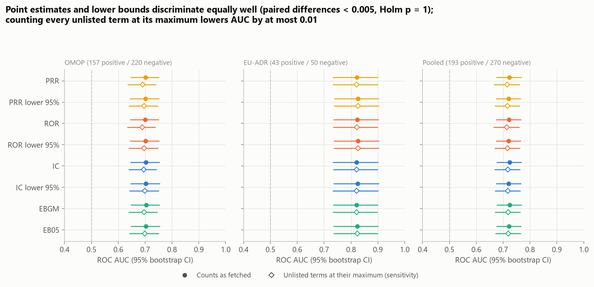
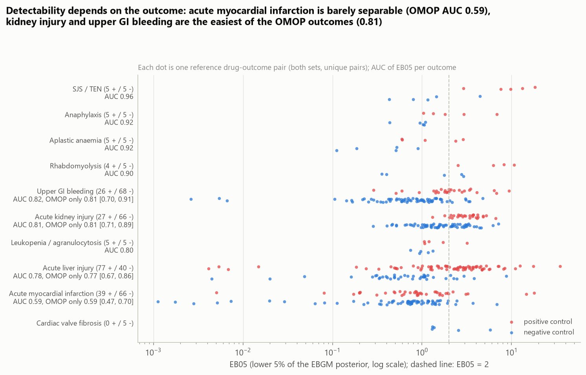
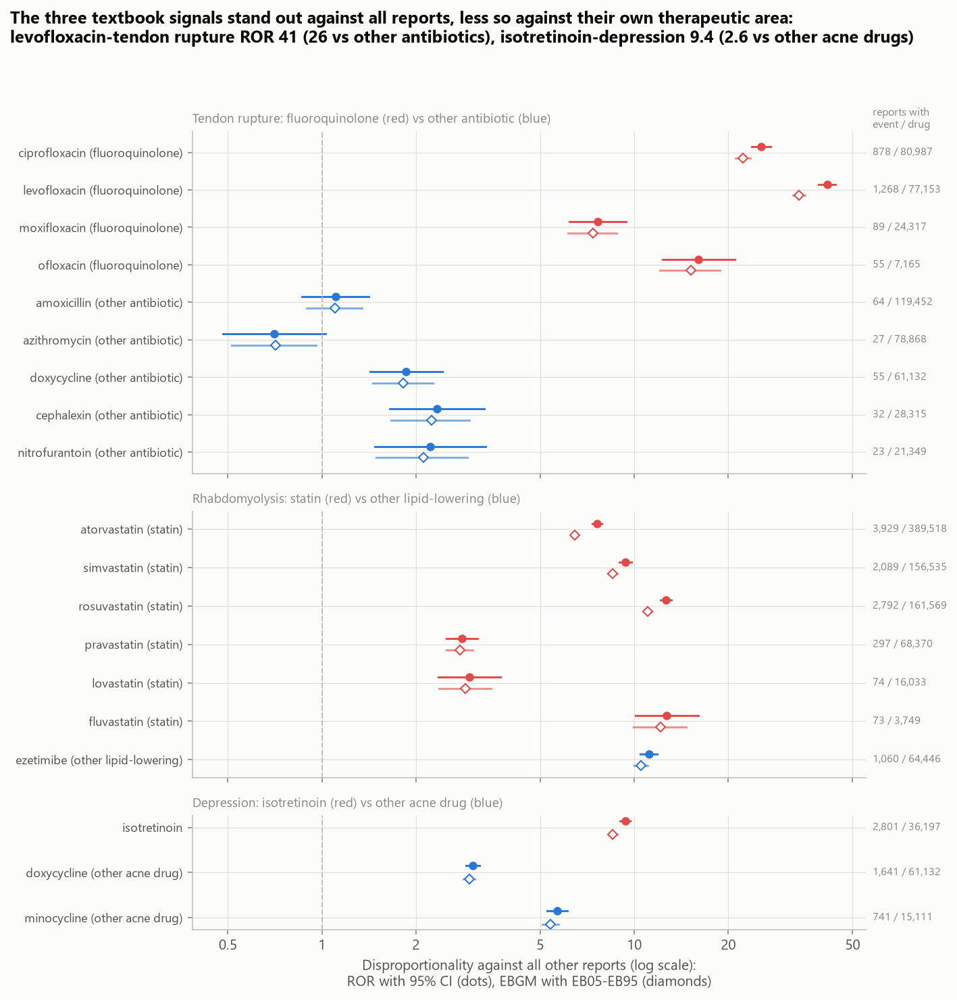
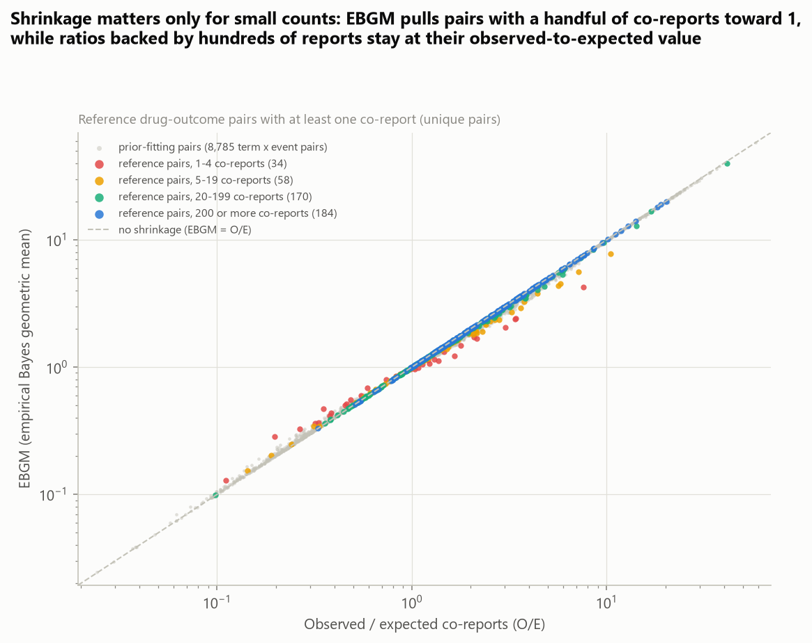
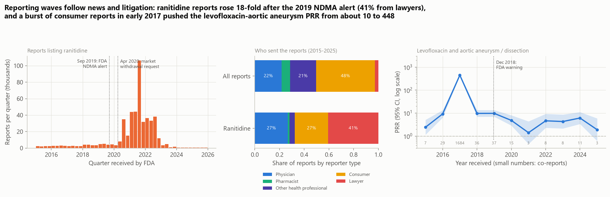
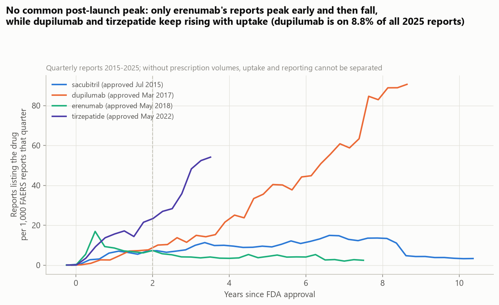

# Detecting Drug Safety Signals in FDA Adverse Event Reports

**Do the four standard disproportionality statistics (PRR, ROR, BCPNN IC and the Gamma-Poisson shrinker's EBGM)
recover known adverse drug reactions from FDA's spontaneous reports, and what makes them fail?** This project builds
2x2 tables for 470 drug-outcome pairs from 15.0 million FAERS reports (2015-2025) using only openFDA count queries,
scores them with all four methods, and checks the scores against two published reference sets of positive and
negative controls (OMOP and EU-ADR).

It mirrors the signal-screening work of a pharmacovigilance team at a drug maker or regulator: every week millions of
unverified reports have to be turned into a short list of drug-event pairs worth a clinical review. The questions are
the ones such a team faces: which statistic to use, which threshold, how well "known" signals are recovered, and how
publicity, litigation and co-prescribed drugs distort the counts.

> **Not medical advice; disproportionality is not causation.** A high PRR or EBGM means a drug and an event are
> reported together more often than expected among other reports. Spontaneous reports are unverified, incomplete,
> duplicated and shaped by publicity, litigation and how widely a drug is used, so these scores cannot show that a
> drug causes an event or estimate how often it does. Do not use anything here to make decisions about a medicine;
> ask a doctor or pharmacist. openFDA's own notice applies: do not rely on openFDA to make decisions regarding
> medical care.



## Key findings

| Question | Result | Validation |
|---|---|---|
| How well do the methods separate positive from negative controls? | ROC AUC **0.70** on OMOP (157 positive / 220 negative pairs), **0.82-0.83** on EU-ADR (43 / 50), 0.72 pooled; the eight scores (point estimates and lower bounds) span at most 0.006 within a reference set | 30 paired bootstrap comparisons, all Holm p = 1.0; the OMOP PRR AUC (0.70) is close to the 0.71 Harpaz et al. (2013) reported for PRR on the same reference set in FAERS through 2011 |
| Which threshold? | EB05 >= 2 flags 51% of positive controls at 82% specificity; IC lower bound > 0 flags 75% at 55% specificity; PRR (Evans) sits in between (61% / 75%) | pooled 463 unique pairs ([`signal_thresholds.csv`](reports/results/signal_thresholds.csv)) |
| Which outcomes are detectable? | acute kidney injury and upper GI bleeding AUC 0.81, acute liver injury 0.77, **acute myocardial infarction 0.59** [0.47, 0.70] (OMOP, EB05) | Harpaz et al. also found AMI the least detectable OMOP outcome (0.58-0.67) |
| Do the textbook signals show up? | levofloxacin-tendon rupture ROR **41** [39, 44], atorvastatin-rhabdomyolysis 7.6, isotretinoin-depression 9.4; against drugs of the same therapeutic area the ratios fall to 26, 0.6 and **2.6** | comparators: other antibiotics, ezetimibe, other acne antibiotics |
| How much do reporting waves matter? | ranitidine reports rose 18-fold after the 2019 NDMA alert (41% sent by lawyers, against 2.8% of all reports); 1,684 consumer-driven levofloxacin + aortic aneurysm reports in 2017 lifted that year's PRR to 448 (1.4-9.7 in the other years) | reporter type from `primarysource.qualification` |
| Are the counts right? | term-summed counts match exact openFDA searches within 2.5% in 15 of 18 checks; one co-report count is 11% high, two drug totals 22-29% low | 20 random checks against `meta.results.total` ([`validation_counts.csv`](reports/results/validation_counts.csv)) |

1. **The choice of statistic hardly matters; the data does.** PRR, ROR, IC and EBGM rank the 470 evaluable pairs
   almost identically (Spearman rank correlation 0.94-1.00), and their AUCs span at most 0.006 within any
   reference set; using the lower 95% bound instead of the point estimate changes nothing either. What changes the
   answer is which reference set is used (OMOP 0.70, EU-ADR 0.82), which outcome is targeted (AMI 0.59, kidney injury
   0.81) and whether the drug has enough reports: AUC is 0.75 for pairs whose drug has at least 1,000 reports and 0.59
   [0.46, 0.71] below that.
2. **Shrinkage only matters where counts are small, and FAERS counts are rarely small.** With 15 million reports,
   412 of the 463 pooled pairs have at least 5 co-reports and their EBGM sits on the observed-to-expected ratio; only
   pairs with a handful of co-reports are pulled towards 1. The signal rules therefore differ mostly by threshold:
   EB05 >= 2 asks for a lower bound of 2 and is the most specific (82%) but misses half the positive controls, while
   the ROR and IC rules ask for a lower bound above 1 and flag three quarters of them at 52-55% specificity.
3. **Many "false positives" are confounding by indication or co-prescription.** The highest-scoring negative controls
   include sucralfate (prescribed for duodenal ulcer) with upper GI bleeding, gatifloxacin (pyelonephritis) with kidney
   injury, furosemide (heart failure) with cardiac valve disease, lactulose (also used for hepatic encephalopathy) with
   liver injury, and the HIV drugs darunavir and nelfinavir with kidney injury, plausibly carried by co-prescribed
   tenofovir, whose label warns of kidney toxicity. One OMOP "negative", monobasic sodium phosphate with kidney injury
   (EB05 3.8), is arguably misclassified: oral sodium phosphate bowel preparations carry an FDA boxed warning for acute
   phosphate nephropathy.
4. **Comparators change the story.** Against all other reports, levofloxacin-tendon rupture has ROR 41; against
   amoxicillin, azithromycin, doxycycline, cephalexin and nitrofurantoin it is 26 [22, 30], still a strong signal.
   Isotretinoin-depression drops from 9.4 to 2.6 [2.5, 2.8] against doxycycline and minocycline, whose own depression
   RORs are 3.0 and 5.7: people treated for severe acne differ from the average FAERS patient. Ezetimibe is a poor
   comparator for statins (rhabdomyolysis ROR 11.1) because 16% of its reports are statin combination products and it
   is usually prescribed as an add-on to a statin.
5. **Reporting waves can dwarf any pharmacological signal.** Ranitidine went from about 12,500 reports a year to
   226,230 in 2021, and 41% of its reports came from lawyers. An unsupervised screen of atorvastatin's reports ranks
   type 2 diabetes first (EB05 11.5, above rhabdomyolysis), but 82% of those 5,824 reports were sent by lawyers; the
   same holds for chronic kidney disease with atorvastatin (50%) and levofloxacin (60%) and for ulcerative colitis with
   isotretinoin (88%). A burst of 1,681 levofloxacin + aortic aneurysm reports in the first half of 2017, at least 95%
   of them from consumers, lifted that pair's PRR from about 10 to 448 for one year.

## Results

### Every method, every reference set



| ROC AUC [95% CI] | PRR | ROR | IC | EBGM | PRR lower 95% | ROR lower 95% | IC lower 95% | EB05 |
|---|---:|---:|---:|---:|---:|---:|---:|---:|
| OMOP (157 + / 220 -) | 0.701 | 0.700 | 0.703 | 0.704 | 0.701 [0.64, 0.75] | 0.701 [0.64, 0.75] | 0.703 [0.64, 0.76] | 0.703 [0.65, 0.76] |
| EU-ADR (43 + / 50 -) | 0.822 | 0.823 | 0.821 | 0.821 | 0.827 [0.74, 0.90] | 0.826 [0.74, 0.90] | 0.824 [0.73, 0.90] | 0.824 [0.73, 0.90] |
| Pooled unique pairs (193 + / 270 -) | 0.723 | 0.722 | 0.724 | 0.725 | 0.720 [0.67, 0.77] | 0.720 [0.67, 0.77] | 0.720 [0.67, 0.77] | 0.721 [0.67, 0.77] |

<sub>Stratified bootstrap (2,000 resamples) for CIs and paired differences, Holm correction over the 10 comparisons
per set ([`auc.csv`](reports/results/auc.csv), [`auc_tests.csv`](reports/results/auc_tests.csv)). The PRR and ROR
lower bounds rank pairs identically here, so their ROC curves overlap. Diamonds in the figure: the same analysis
with every term left unlisted by openFDA's 999-term cap counted at its maximum possible value (AUC lower by at
most 0.010).</sub>

Conventional signal rules on the pooled pairs ([`signal_thresholds.csv`](reports/results/signal_thresholds.csv)):

| Rule | Flagged | Sensitivity | Specificity | PPV |
|---|---:|---:|---:|---:|
| PRR >= 2, chi-square >= 4, a >= 3 (Evans et al. 2001) | 184 | 0.61 | 0.75 | 0.64 |
| ROR lower 95% > 1, a >= 3 | 275 | 0.75 | 0.52 | 0.53 |
| IC lower 95% > 0 | 265 | 0.75 | 0.55 | 0.54 |
| EB05 >= 2 | 148 | 0.51 | 0.82 | 0.67 |

The rules differ in where they sit on what is essentially one shared ROC curve, not in how well they rank: the frequentist lower
bounds flag far more pairs, EB05 >= 2 far fewer.

### Detectability by outcome and by data volume



| Outcome (OMOP pairs) | Positive / negative | AUC of EB05 [95% CI] |
|---|---:|---:|
| Acute kidney injury | 24 / 61 | 0.81 [0.71, 0.89] |
| Upper GI bleeding | 23 / 63 | 0.81 [0.70, 0.91] |
| Acute liver injury | 75 / 35 | 0.77 [0.67, 0.86] |
| Acute myocardial infarction | 35 / 61 | 0.59 [0.47, 0.70] |

<sub>[`auc_by_outcome.csv`](reports/results/auc_by_outcome.csv); the six EU-ADR-only outcomes have 5 positive and
5 negative pairs each (cardiac valve fibrosis: negatives only), so their AUCs (0.80-0.96) are too imprecise to rank.
[`auc_by_drug_size.csv`](reports/results/auc_by_drug_size.csv): AUC 0.75 [0.70, 0.80] for the 388 pooled pairs whose
drug has at least 1,000 reports, 0.59 [0.46, 0.71] for the other 75.</sub>

Myocardial infarction is common among the people who take most drugs and is reported for many reasons, so one
drug's share of MI reports moves little: only 2 of the 35 OMOP myocardial-infarction positive controls reach
EB05 >= 2 (indomethacin, dipyridamole), against 3 of 61 negatives. The EU-ADR positives rofecoxib and rosiglitazone
do stand out (EB05 14.6 and 17.9). Five positive controls with no co-report at all are drugs with only 100-330
reports in 2015-2025 (enalaprilat, amoxapine, tolcapone, moexipril, gemifloxacin).

### Textbook signals and comparators



| Pair | Co-reports / drug reports | ROR vs all reports | ROR vs comparator group [95% CI] | EB05 |
|---|---:|---:|---:|---:|
| levofloxacin - tendon rupture | 1,268 / 77,153 | 41.4 | 25.7 [22.1, 29.8] vs other antibiotics | 32.2 |
| ciprofloxacin - tendon rupture | 878 / 80,987 | 25.5 | 16.8 [14.5, 19.6] | 21.0 |
| ofloxacin - tendon rupture | 55 / 7,165 | 16.0 | 11.9 [8.8, 16.0] | 12.1 |
| moxifloxacin - tendon rupture | 89 / 24,317 | 7.6 | 5.7 [4.4, 7.3] | 6.2 |
| atorvastatin - rhabdomyolysis | 3,929 / 389,518 | 7.6 | 0.61 [0.57, 0.65] vs ezetimibe | 6.3 |
| rosuvastatin - rhabdomyolysis | 2,792 / 161,569 | 12.6 | 1.05 [0.98, 1.13] | 10.7 |
| isotretinoin - depression | 2,801 / 36,197 | 9.4 | 2.6 [2.5, 2.8] vs doxycycline, minocycline | 8.3 |

<sub>[`textbook_pairs.csv`](reports/results/textbook_pairs.csv),
[`textbook_vs_comparators.csv`](reports/results/textbook_vs_comparators.csv). The comparator ROR is computed
between the drug's reports and the comparator group's reports only (an active-comparator analysis within FAERS).
Atorvastatin-rhabdomyolysis is also an EU-ADR positive control.</sub>

All four fluoroquinolones show tendon rupture far above every comparator antibiotic, which is what a real, labelled
class effect looks like. The statin comparison shows the opposite lesson: ezetimibe "has" a rhabdomyolysis signal
of its own because it is taken with statins, so the within-class ratio says nothing about statins.

### Shrinkage



The GPS prior, fitted by maximum likelihood on 8,785 active-substance term x event pairs, is a mixture of
Gamma(1.47, 1.04) with weight 0.75 (mean ratio 1.4) and Gamma(0.44, 0.15) (mean 3.0). Reference pairs with fewer than
5 co-reports are pulled towards 1 (and their lower bounds far below it); pairs with hundreds of co-reports are not.

### What a screen surfaces

The three drugs' full reaction profiles (every MedDRA term reported with the drug whose overall count is known) ranked
by EB05 ([`screening_pts.csv`](reports/results/screening_pts.csv)):

| Drug | Top terms by EB05 (co-reports) | Where the labelled reaction ranks |
|---|---|---|
| levofloxacin | tendonitis (1,735), tendon rupture (1,268), blood calcium decreased, orthostatic hypotension, end stage renal disease | tendon rupture 2nd |
| atorvastatin | type 2 diabetes mellitus (5,894), mixed liver injury, rhabdomyolysis (3,913), cholestatic hepatitis, hypomagnesaemia | rhabdomyolysis 3rd |
| isotretinoin | lip dry (880), blood triglycerides increased, mood altered, product administration interrupted, exposure during pregnancy | depression 8th |

| Pair flagged above | Reports | From lawyers | From consumers | From health professionals |
|---|---:|---:|---:|---:|
| atorvastatin - type 2 diabetes mellitus | 5,824 | 82% | 8% | 10% |
| atorvastatin - chronic kidney disease | 4,896 | 50% | 21% | 28% |
| levofloxacin - chronic kidney disease | 2,020 | 60% | 21% | 19% |
| isotretinoin - ulcerative colitis | 656 | 88% | 6% | 6% |
| levofloxacin - aortic aneurysm / dissection | 1,839 | 0.2% | 95% | 4% |
| all reports 2015-2025 | 14,740,922 | 2.8% | 48% | 50% |

<sub>[`reporter_mix_checks.csv`](reports/results/reporter_mix_checks.csv), [`reporter_mix.csv`](reports/results/reporter_mix.csv).
These five pairs were chosen after reading the screen and the time series, so the table illustrates rather than tests.
Kidney-disease reports listing atorvastatin or levofloxacin are plausibly litigation reports about another drug the
patient also took (FAERS lists every drug a patient was on); the statin-diabetes and isotretinoin-colitis links are
both in the drugs' labels and the subject of past litigation, and these counts cannot separate the two.</sub>

### Stimulated reporting and new drugs





Quarterly report counts ([`time_series_quarterly.csv`](reports/results/time_series_quarterly.csv)) show two kinds of
waves. Regulatory news and litigation: ranitidine reports jumped after FDA's NDMA alert (September 2019) and the
withdrawal request (April 2020), peaking at 106,270 in one quarter (2021 Q3). And new-drug uptake: the Weber effect
(reports peaking about two years after launch, then falling) appears only for erenumab, whose share of reports peaked
half a year after approval; dupilumab and tirzepatide reports keep rising (dupilumab is on 8.8% of all 2025
reports), and sacubitril/valsartan's share rose for about seven years before falling by more than half from 2024.
Without prescription volumes, uptake and reporting intensity cannot be separated.

## Data

| | |
|---|---|
| Reports | [openFDA drug adverse event API](https://open.fda.gov/apis/drug/event/) (`api.fda.gov/drug/event.json`, no key), FDA Adverse Event Reporting System (FAERS); all **15,028,315** reports received 2015-01-01 to 2025-12-31 (of 20,692,690 in openFDA); openFDA `last_updated` 2026-07-30; fetched 2026-10-10 |
| Drugs | `patient.drug.activesubstance.activesubstancename`, FDA's active-ingredient field, filled in on 100% of reports from 2015 but 57% in 2014 and under 5% before, which set the window ([`active_ingredient_coverage.csv`](reports/results/active_ingredient_coverage.csv)); 238 ingredients matched to 652 active-substance terms ([`drug_terms.csv`](reports/results/drug_terms.csv)) |
| Events | MedDRA preferred terms, `patient.reaction.reactionmeddrapt.exact`; 10 outcome definitions of 1-16 PTs each and 2 single-PT events ([`outcome_definitions.csv`](reports/results/outcome_definitions.csv)) |
| Controls | OMOP reference set (Ryan et al. 2013): 165 positive / 234 negative controls, 4 outcomes; EU-ADR reference set (Coloma et al. 2013): 43 / 50, 10 outcomes; both as distributed in the OHDSI [MethodEvaluation](https://github.com/OHDSI/MethodEvaluation) R package (Apache-2.0) |
| Requests | 296 distinct openFDA queries reproduce every table, one network call each; 437 calls in total during development, including 100 for a dropped sensitivity analysis and 41 exploratory or superseded queries; every response cached with its URL and fetch time ([`query_provenance.csv`](reports/results/query_provenance.csv)) |
| License | openFDA data are public domain (CC0 1.0); reference sets Apache-2.0 (OHDSI); MedDRA terms appear only as they occur in the public FAERS data |

The three OMOP entries for pancreatic enzymes (amylases, lipase, endopeptidases) all map to pancrelipase and are kept
once, leaving 391 OMOP pairs; 7 drugs (alatrofloxacin, pemoline, sulfisoxazole, thiabendazole, tolmetin,
trovafloxacin, zalcitabine) have no report in the window, so 377 OMOP and all 93 EU-ADR pairs are evaluable. Seven
drug-outcome pairs are in both sets with the same label; the pooled analysis counts them once (463 pairs).

## Method

**Counting unit.** One openFDA record is one FAERS safety report in its latest version. Every count here is a number
of *reports*: not patients (a patient can be reported several times, by several senders) and not drug-event mentions
(a report listing a term twice counts once). openFDA does not merge duplicate reports of one case from different
senders, and count queries cannot de-duplicate them. The `reportduplicate` block is present on 10.5 million of the 15
million reports, so its presence cannot flag duplicates. A drug counts as exposed whenever it is listed, as suspect
or concomitant: openFDA evaluates each search clause against all drugs on a report, so "aspirin AND some drug is
suspect" matched 99.6% of aspirin reports, and drug role cannot be tied to a drug with count queries.

**2x2 tables from count queries.** For drug D and event E, with N = 15,028,315 reports in the window:

| | E | not E |
|---|---|---|
| D | a | b = n_D - a |
| not D | c = n_E - a | d = N - n_D - c |

- N: `meta.results.total` of the window query. n_E: total of reports with *any* of the event's PTs (an exact union;
  summing the PTs would overcount reports with two of them, by 30,536 reports for acute kidney injury).
- a: one count query per event, `search=<window> AND <event PTs>&count=activesubstancename.exact`, gives the number of
  event reports per active-substance term. A drug's count is the sum over its terms (salts and combinations, e.g.
  ATORVASTATIN, ATORVASTATIN CALCIUM, AMLODIPINE BESYLATE\ATORVASTATIN CALCIUM).
- n_D: the same per-term counts from batched queries restricted to the reports of 1-15 drugs.

**The 999-term cap.** Without an API key openFDA returns at most 999 terms per count query (a request for 1,000 is
refused with `API_KEY_MISSING`), so every table lists only terms above a cut-off (12 reports for rhabdomyolysis,
146 for kidney injury). When one of a drug's terms falls below the cut-off and could change its count by more than
3 reports or 1%, the event's count query is re-run on the reports that mention the drugs in question (a search on the
drug names), first in batches and then one drug at a time. Within that subset the drug's terms rank high enough to be
listed and their counts are exact. Of the 470 evaluable pairs, 149 came straight from the event tables, 157 from
batched and 164 from single-drug re-counts; 26 pairs could still be short by more than 1%, 23 of them by at most 3
reports. Rerunning the evaluation with every unlisted term at its maximum possible count lowers AUC by at most 0.010.

**Statistics** ([`pvsignals/disproportionality.py`](pvsignals/disproportionality.py), [`pvsignals/gps.py`](pvsignals/gps.py)):

- PRR = [a / (a + b)] / [c / (c + d)], 95% CI exp(ln PRR +/- 1.96 sqrt(1/a - 1/(a+b) + 1/c - 1/(c+d))).
- ROR = ad / bc, 95% CI exp(ln ROR +/- 1.96 sqrt(1/a + 1/b + 1/c + 1/d)).
- IC = log2[(a + 0.5) / (E + 0.5)], E = n_D n_E / N, the shrunk information component of the Uppsala Monitoring
  Centre's BCPNN (Noren et al. 2013); the 95% credibility interval comes from the Gamma(a + 0.5, E + 0.5) posterior.
- EBGM (DuMouchel 1999): the true ratio has a two-gamma mixture prior, a ~ Poisson(lambda E), so a is marginally a
  mixture of negative binomials; the prior is fitted by maximum likelihood on 8,785 term x event pairs from the 12
  event tables, each pair's likelihood conditioned on a exceeding its table's cut-off (DuMouchel's truncated
  likelihood with the cut-off set by the 999-term cap). EBGM = exp(E[log lambda | a]); EB05 and EB95 are posterior
  quantiles.
- Pairs with a = 0 have no PRR or ROR; for ranking they get 0, below every pair with a co-report (IC and EBGM are
  defined there).

**Outcome definitions.** The reference sets were built for outcomes defined in claims and health-record data; each is
mapped here to a narrow list of MedDRA preferred terms written for this project (for example, acute kidney injury:
ACUTE KIDNEY INJURY, RENAL FAILURE, RENAL INJURY, NEPHROPATHY TOXIC, RENAL TUBULAR NECROSIS, PRERENAL FAILURE,
ANURIA, and the older RENAL FAILURE ACUTE, which no longer occurs after 2014). They are not MedDRA SMQs and were not
independently validated.

**Drug names.** Reference-set names are matched to active-substance terms by rules ([`pvsignals/reference.py`](pvsignals/reference.py)):
a term matches when one of its components starts with the ingredient name (so "estradiol" matches ESTRADIOL VALERATE
but not ETHINYL ESTRADIOL, "niacin" does not match NIACINAMIDE), with 25 explicit rules for names that differ in
FAERS (thyroxine -> levothyroxine, tetrahydrocannabinol -> dronabinol, valproate -> valproic acid / divalproex ...).
Every matched term is listed in [`drug_terms.csv`](reports/results/drug_terms.csv).

**Evaluation.** AUC is the Mann-Whitney probability that a positive control outscores a negative one; 95% CIs from a
stratified bootstrap (2,000 resamples); paired bootstrap for differences between scores, Holm-adjusted within each
reference set. Signal rules use their published thresholds.

**Counting check.** For 10 random drugs and 10 random drug-outcome pairs, the term-summed count was compared with an
exact openFDA search total (`search=activesubstancename:"<drug>"`). Excluding estradiol (whose search also matches
ethinyl estradiol, so the two are not comparable), 15 of 18 agree within 2.5% (9 exactly). Diltiazem-liver injury is
11% high, most likely from reports that list both DILTIAZEM and DILTIAZEM HYDROCHLORIDE (counted twice by the term
sum); moexipril
and benzocaine totals are 22% and 29% low because their rarer combination-product terms fell below the discovery
cut-off, which removes them from both n_D and a.

## Validation and limitations

- **Reference-set error.** Hauben, Aronson and Ferner (2016) argue that 40 of OMOP's 233 negative controls (17%) are
  or may be misclassified; sodium phosphate with kidney injury, which scores as a signal here, is a likely example.
  The reference sets were also built for longitudinal data, not spontaneous reports, and the outcome definitions used
  here are this project's PT lists. Absolute AUCs depend on all of this; the comparison between methods does not.
- **Comparison with published results.** Harpaz et al. (2013) evaluated these methods on the OMOP set in FAERS
  1968-2011 after removing duplicates: PRR AUC 0.71, EB05 0.76 (0.79 with stratification by age, sex and year). This
  run reproduces the PRR value (0.70) and the weakness on myocardial infarction, but its EB05 is lower (0.70). It uses
  a different period, no de-duplication, no stratification and ingredient matching of its own, so the gap cannot be
  attributed to any one of these.
- **Any-role exposure.** Counting concomitant drugs lets a strong signal of one drug spill onto drugs commonly taken
  with it (the tenofovir partners, ezetimibe with statins, kidney-disease reports listing atorvastatin). Suspect-only
  analyses need the quarterly FAERS files, where role and drug sit on the same row.
- **Counts are approximate where noted.** Summing a drug's terms counts a report twice when it lists two of them, and
  drops terms rarer than the discovery cut-off; the checks above put typical errors within 2.5% and the worst at
  -29% (drug total) and +11% (co-reports). The 999-term cap leaves 26 pairs possibly short by more than 1%.
- **No masking or stratification adjustments.** Mass reporting about one drug (ranitidine) inflates the
  background of its events for every other drug; neither the background nor the GPS prior is stratified by age, sex
  or report year.
- **Window and withdrawn drugs.** The 2015-2025 window, chosen because the active-ingredient field is complete only
  from 2015, contains few reports of drugs withdrawn earlier: 7 reference drugs have none, and rofecoxib and valdecoxib,
  withdrawn in 2004 and 2005, have 1,717 and 247.
- **Post hoc illustrations.** The textbook comparators, the screened drugs and the five reporter-type checks were
  chosen to illustrate biases (the checks after reading the screen); they are examples, not tests.
- **Cut for the request budget.** A sensitivity analysis restricted to reports from health professionals was started
  and dropped: re-counting its truncated pairs exactly would have taken the day's openFDA requests (shared with other
  work from the same address) close to the 1,000-per-day limit. The screen covers only terms with at least 6,214
  reports overall (the 999 most reported) plus the terms of the outcome definitions.
- **Compute.** About 14 minutes of wall time over all runs, mostly waiting for openFDA responses; a cached re-run
  takes about 1 minute on 2 CPU threads (GPS fit and bootstrap). No GPU.

## Reproduce

```bash
pip install -r requirements.txt
python scripts/run_pipeline.py --quick    # smoke test: 2 outcomes, ~25 openFDA requests, outputs in data/cache/smoke/
python scripts/run_pipeline.py            # full run: ~300 requests with an empty cache (well under 1,000 a day)
python scripts/run_pipeline.py --offline  # re-run from the cache only
python scripts/make_figures.py            # redraw figures from reports/results/
pytest
```

openFDA responses are cached in `data/raw/openfda/` (one JSON file per query with the URL and fetch time), the
reference sets in `data/raw/reference/`, and every network call is appended to `data/raw/openfda_request_log.jsonl`.
The client refuses to go past 600 requests in 24 hours. openFDA updates FAERS quarterly and can revise older reports,
so a fresh run will give slightly different counts.

## Project structure

```
pvsignals/
  openfda.py            cached, rate-limited openFDA client (URL + fetch time stored with every response, daily budget)
  reference.py          OMOP / EU-ADR reference sets, outcome PT lists, ingredient-to-term matching rules
  collect.py            2x2 counts from count queries: term discovery, event tables, subset re-counts for the 999 cap
  disproportionality.py PRR, ROR (with CIs), Yates chi-square, shrunk IC with credibility interval
  gps.py                Gamma-Poisson shrinker: truncated-likelihood prior fit, EBGM, EB05 / EB95
  evaluation.py         AUC, ROC, stratified and paired bootstrap, Holm, signal-rule metrics
  figures.py            all report figures; plotting.py shared colorblind-safe styling
scripts/                run_pipeline.py (everything), make_figures.py
notebooks/              analysis.ipynb, the walkthrough with tables
reports/                figures/ and results/ (every number above, every scored pair, every query URL)
tests/                  2x2 statistics against hand calculations and scipy, GPS on simulated data, count assembly
                        and the 999-term fill-in against a fake openFDA, client caching, name matching, metrics
```

## License and citations

MIT; see [LICENSE](LICENSE). openFDA data are public domain (CC0 1.0); the reference sets come from OHDSI
MethodEvaluation (Apache-2.0). Not medical advice.

- Ryan PB, Schuemie MJ, Welebob E, et al. Defining a reference set to support methodological research in drug safety.
  *Drug Safety* 2013;36 Suppl 1:S33-47.
- Coloma PM, Avillach P, Salvo F, et al. A reference standard for evaluation of methods for drug safety signal
  detection using electronic healthcare record databases. *Drug Safety* 2013;36:13-23.
- Harpaz R, DuMouchel W, LePendu P, et al. Performance of pharmacovigilance signal-detection algorithms for the FDA
  adverse event reporting system. *Clin Pharmacol Ther* 2013;93:539-546.
- Hauben M, Aronson JK, Ferner RE. Evidence of misclassification of drug-event associations classified as gold
  standard 'negative controls' by the Observational Medical Outcomes Partnership (OMOP). *Drug Safety* 2016;39:421-432.
- DuMouchel W. Bayesian data mining in large frequency tables, with an application to the FDA spontaneous reporting
  system. *Am Stat* 1999;53:177-190.
- Noren GN, Hopstadius J, Bate A. Shrinkage observed-to-expected ratios for robust and transparent large-scale pattern
  discovery. *Stat Methods Med Res* 2013;22:57-69.
- Evans SJW, Waller PC, Davis S. Use of proportional reporting ratios (PRRs) for signal generation from spontaneous
  adverse drug reaction reports. *Pharmacoepidemiol Drug Saf* 2001;10:483-486.
